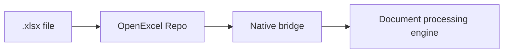

# OpenExcel


CLI/SDK for Excel `.xlsx` read/write, formula evaluation, and pivot aggregation. The processing engine handles all formats internally, exposing a native bridge to Node.js consumers and end users.

Key differentiators: a self-contained formula engine (not a wrapper around Excel) and data-pivot aggregation primitives on top of native `.xlsx` support.

## 🧩 Architecture



## What's NOT here

- **No `.xlsx` parser or writer implementation** — workbook, sheet, cell, style, and shared-string handling belongs in the shared engine.
- **No formula engine** — the self-contained expression evaluator (A1 refs, ranges, built-in functions) lives in the processing engine, not here.
- **No pivot-table execution** — pivot aggregation, grouping, and layout are core logic in the engine; this repo only wires up the API surface.
- **No fixture corpus** — golden `.xlsx` files, conformance fixtures, and round-trip acceptance scripts live downstream.

## 🚀 Usage (placeholder)

```bash
# List sheets and cell counts
open-excel inspect workbook.xlsx

# Export sheet to CSV or JSON
open-excel export workbook.xlsx --sheet Sheet1 --format csv -o sheet.csv

# Evaluate and re-save (useful when formulas need refreshing)
open-excel recalc workbook.xlsx -o recalculated.xlsx

# Pivot aggregate
open-excel pivot workbook.xlsx --rows category --cols month --values sales --sum -o pivot.xlsx
```

```ts
import { OpenExcel } from '@wae/open-excel';

const wb = await OpenExcel.read('workbook.xlsx');
const sheet = wb.sheets['Sheet1'];

// self-contained formula evaluation — no Excel required
const result = await sheet.evaluate('=SUM(B2:B100)');

await wb.write('updated.xlsx');
```

## 🧱 Repo layout

```
OpenExcel/
├── package.json
└── Readme.md
```

This is a scaffold repo. The native bridge wiring, CLI binary, and CLI entry points are added incrementally as the shared processing engine lands.
