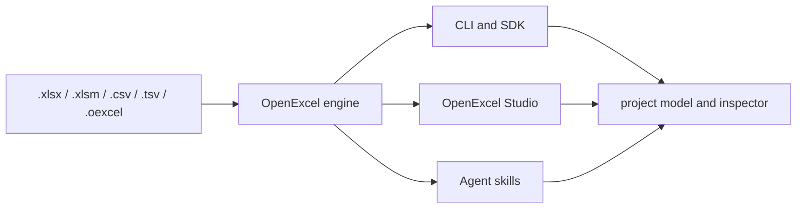

# OpenExcel


CLI and SDK for Excel `.xlsx` workbooks: reading, editing, inspecting and
exporting on one declared project model. The processing engine is shared by the
command line, the studio window and agent workflows, so a workbook reported in
one surface behaves the same in the others.

## Architecture



## What it does

- Reads `xlsx`/`xlsm` through the pinned `document-formats` XLSX importer and
  projects them into one editable, serializable `open-excel/project` model.
- Reads `csv`/`tsv` with quoted fields, escaped quotes and embedded newlines.
- Writes native project JSON atomically, and exports `xlsx`, `csv`, `tsv`,
  `json` and `html`.
- The XLSX writer emits a SpreadsheetML package with inline strings, styles,
  numbers, booleans, formulas with cached results, merged cells, column widths,
  row heights and frozen panes. Every written package is read back and compared
  with the project before the file is moved into place.
- Runs six checks on the project model: `formulas`, `references`, `cycles`,
  `types`, `ranges` and `styles`.
- Edits cells, sheets and ranges with revision-conflict detection, and renders a
  sheet grid as SVG.
- Classifies the whole workbook family: `xlsx`, `xlsm`, `xltx`, `xls`, `csv`,
  `tsv`, `ods`, `json`, `xml` and `pdf`.

## What it does NOT do

- **No formula calculation.** Formulas are stored, inspected and written; cached
  results are only preserved from the source file or supplied by the caller.
- **No `xls`, `ods` or `xml` import**, no `pdf`/`png` rendering, no PDF export,
  and no macro-preserving `xlsm` export. The capability matrix reports
  `unsupported` for each.
- **No capability claims from file extensions.** Classification is not support;
  read `capabilities()` before promising a format.

## Usage

```bash
# Show what this build supports
open-excel capabilities

# Create, inspect and export a workbook project
open-excel create --out ledger.oexcel --title "Ledger"
open-excel inspect ledger.oexcel --checks formulas,references,cycles
open-excel export ledger.oexcel --format xlsx --out ledger.xlsx

# Edit one cell and save the result
open-excel edit ledger.oexcel --cell A1 --value 42 --out ledger.oexcel --overwrite
open-excel edit ledger.oexcel --cell B2 --formula "=A1*2" --out ledger.oexcel --overwrite

# Print the current summary, or save a copy
open-excel summary ledger.oexcel
open-excel save ledger.oexcel --out copy.oexcel
```

```ts
import { OpenExcel, OpenExcelError } from '@wae/open-excel';

const excel = new OpenExcel({ locale: 'en' });
const ledger = await excel.create({ title: 'Ledger' });

const edited = await excel.edit(ledger, {
    operations: [
        { op: 'cell.set', sheet: 'Sheet1', reference: 'A1', value: 42 },
        { op: 'cell.set', sheet: 'Sheet1', reference: 'B1', formula: '=A1*2' },
    ],
});
console.log(edited.revision);

await excel.save(edited.workbook, { target: 'ledger.oexcel', overwrite: true });
await excel.export(edited.workbook, { format: 'xlsx', target: 'ledger.xlsx', overwrite: true });

const rendered = await excel.render(edited.workbook, { sheet: 'Sheet1' });
console.log(rendered.svg.startsWith('<svg'));
```

## Repo layout

```
OpenExcel/
├── package.json
├── readme.md
└── projects/
    ├── crates/
    │   ├── model/                   # project model, XLSX/CSV I/O, checks, SVG
    │   └── napi/                    # Node-API and WebView bindings
    ├── packages/
    │   ├── open-excel/              # command line and SDK
    │   ├── open-excel-skills/       # agent skills
    │   ├── open-excel-ui/           # studio shell
    │   └── open-excel-<platform>-<arch>/   # prebuilt addon packages
    └── sites/
        └── homepage/                # product site
```

## Status

The workbook model, XLSX importer, XLSX writer, CSV/TSV reader, inspection
rules, revision-aware editor, SVG renderer, CLI commands and SDK methods are
implemented in `projects/crates/model`. Formula evaluation and pivot aggregation
remain delegated to upstream work and are not claimed by the capability matrix.

## License

MPL-2.0. See [License.md](License.md).
