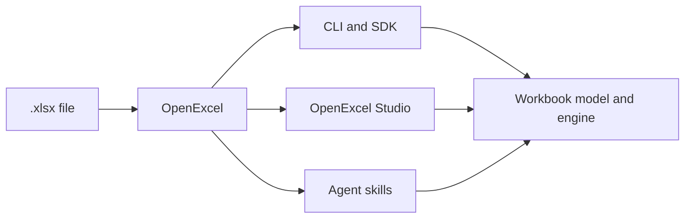

# OpenExcel


CLI and SDK for Excel `.xlsx` workbooks: reading, writing, formula evaluation and
pivot aggregation on one model. The processing engine is shared by the command
line, the studio window and agent workflows, so a workbook reported in one
surface behaves the same in the others.

Key differentiators: a self-contained formula engine (not a wrapper around
Excel) and data-pivot aggregation primitives on top of native `.xlsx` support.

## Architecture



## What it does

- Classifies the whole workbook family: `xlsx`, `xlsm`, `xltx`, `xls`, `csv`,
  `tsv`, `ods`, `json`, `xml` and `pdf`.
- Declares six inspection checks — `formulas`, `references`, `cycles`, `types`,
  `ranges` and `styles` — plus the `svg`, `png` and `pdf` render targets and the
  `xlsx`, `xlsm`, `csv`, `json` and `pdf` export targets.
- Ships one command line, one SDK entry point and one desktop shell that all read
  the same capability matrix.

## What it does NOT do

- **No workbook engine yet.** Reading, writing, recalculation, pivot execution,
  rendering and export are not implemented.
- **No `.xlsx` parser, writer or formula evaluator in this repository** — that
  logic belongs to the shared processing engine.
- **No fixture corpus** — golden workbooks, conformance fixtures and round-trip
  acceptance scripts live downstream.
- **No capability claims from file extensions.** Classification is not support.

Because there is no engine, every domain operation currently rejects with the
stable code `capability/not-implemented`. The matrix returned by `capabilities`
reports that honestly instead of guessing.

## Usage

```bash
# Show what this build supports (everything domain-level is not-implemented)
open-excel capabilities

# Create a workbook project file
open-excel create --out ledger.oexcel --title "Ledger" --template blank

# Open a project file and print its sheets and cells
open-excel open ledger.oexcel

# Run formula, reference and range checks
open-excel inspect ledger.oexcel --checks formulas,references,ranges

# Export to an exchange format
open-excel export ledger.oexcel --format csv --out ledger.csv

# Open the studio window
open-excel gui
```

```ts
import { OpenExcel, OpenExcelError } from '@wae/open-excel';

const excel = new OpenExcel({ locale: 'en' });

try {
    // Rejects with `capability/not-implemented` until the engine lands.
    const workbook = await excel.open({ path: 'ledger.oexcel' });
    console.log(workbook.sheets.length);
} catch (error) {
    if (error instanceof OpenExcelError) {
        console.log(error.code); // capability/not-implemented
    }
}
```

## Repo layout

```
OpenExcel/
├── package.json
├── readme.md
└── projects/
    ├── packages/
    │   ├── open-excel/              # command line and SDK
    │   ├── open-excel-skills/       # agent skills
    │   ├── open-excel-ui/           # studio shell
    │   └── open-excel-<platform>-<arch>/   # prebuilt addon packages
    └── sites/
        └── homepage/                # product site
```

This repository ships the framework around the workbook model: the command line,
the SDK contracts, the studio shell, the product site and the agent skills.
Workbook parsing, formula evaluation, pivot aggregation and export arrive with
the shared processing engine; until then the declared surface stays honest and
rejects domain calls with `capability/not-implemented`.

## Status

Scaffold with a declared surface. The capability matrix, error codes, format
registry, CLI command tree, studio shell and skills routing exist; no workbook is
created, opened, inspected or exported yet.

## License

MPL-2.0. See [License.md](License.md).
