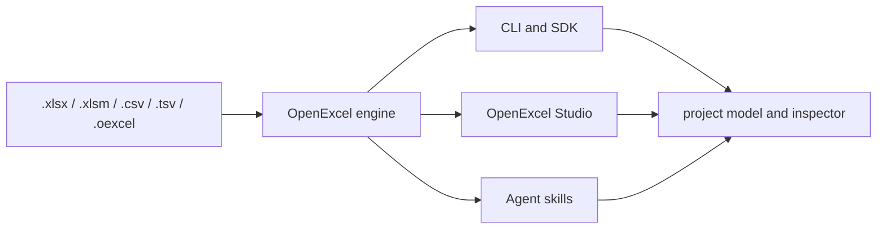

# OpenExcel


CLI and SDK for Excel `.xlsx` workbooks: reading, editing, inspecting and
exporting on one declared project model. The processing engine is shared by the
command line, the studio window and agent workflows, so a workbook reported in
one surface behaves the same in the others.

## Architecture



## What it does

- Reads `xlsx`/`xlsm` through the pinned `document-formats` XLSX importer and
  projects them into one editable, serializable `open-excel/project` model.
- Reads `csv`/`tsv` with quoted fields, escaped quotes and embedded newlines.
- Writes native project JSON atomically, and exports `xlsx`, `csv`, `tsv`,
  `json` and `html`.
- The XLSX writer emits a SpreadsheetML package with inline strings, styles,
  numbers, booleans, formulas with cached results, merged cells, column widths,
  row heights and frozen panes. Every written package is read back and compared
  with the project before the file is moved into place.
- Runs six checks on the project model: `formulas`, `references`, `cycles`,
  `types`, `ranges` and `styles`.
- Evaluates a built-in formula subset (aggregation, lookup, text, statistics and
  math functions such as `SUM`, `VLOOKUP`, `TEXTJOIN`, `MEDIAN` and `SUMPRODUCT`)
  and reports the exact function list through `capabilities()`.
- Edits cells, sheets and ranges with revision-conflict detection, and renders a
  sheet grid as SVG. The CLI exposes cell edits, raw operation batches, range
  sorting, cell styles, sheet add/rename/remove/duplicate/move/hide, frozen-pane
  control and whole-row or whole-column insertion and deletion. Structural edits
  move merged ranges, frozen panes, row heights, column widths and formula
  references with the cells.
- Classifies the whole workbook family: `xlsx`, `xlsm`, `xltx`, `xls`, `csv`,
  `tsv`, `ods`, `json`, `xml` and `pdf`.

## What it does NOT do

- **No calculation for functions outside the implemented list.** A formula using
  an unknown function keeps the cached result from the source file; the engine
  reports it as `unsupported` rather than inventing a value.
- **No `xls`, `ods` or `xml` import**, no `pdf`/`png` rendering, no PDF export,
  and no macro-preserving `xlsm` export. The capability matrix reports
  `unsupported` for each.
- **No capability claims from file extensions.** Classification is not support;
  read `capabilities()` before promising a format.

## Usage

```bash
# Show what this build supports
open-excel capabilities

# Create, inspect and export a workbook project
open-excel create --out ledger.oexcel --title "Ledger"
open-excel inspect ledger.oexcel --checks formulas,references,cycles
open-excel export ledger.oexcel --format xlsx --out ledger.xlsx

# Edit one cell and save the result
open-excel edit ledger.oexcel --cell A1 --value 42 --out ledger.oexcel --overwrite
open-excel edit ledger.oexcel --cell B2 --formula "=A1*2" --out ledger.oexcel --overwrite

# Apply a batch of operations, sort a range, style cells, manage sheets
open-excel edit ledger.oexcel --ops '[{"op":"cell.set","sheet":"Sheet1","reference":"A1","value":7}]'
open-excel sort ledger.oexcel --range A1:C9 --column 3 --header --out ledger.oexcel --overwrite
open-excel format ledger.oexcel --range A1:C1 --bold --fill "#ffeeaa" --out ledger.oexcel --overwrite
open-excel sheet ledger.oexcel --add Notes --out ledger.oexcel --overwrite
open-excel sheet ledger.oexcel --rename Sheet1 --to Ledger --out ledger.oexcel --overwrite
open-excel sheet ledger.oexcel --hide Notes --out ledger.oexcel --overwrite
open-excel sheet ledger.oexcel --show Notes --out ledger.oexcel --overwrite

# Freeze the rows above and the columns left of C2, or clear the pane
open-excel freeze ledger.oexcel --at C2 --out ledger.oexcel --overwrite
open-excel freeze ledger.oexcel --rows 1 --columns 2 --out ledger.oexcel --overwrite
open-excel freeze ledger.oexcel --clear --out ledger.oexcel --overwrite

# Insert or delete whole rows and columns
open-excel row ledger.oexcel --insert 3 --count 2 --out ledger.oexcel --overwrite
open-excel row ledger.oexcel --delete 7 --out ledger.oexcel --overwrite
open-excel column ledger.oexcel --insert B --out ledger.oexcel --overwrite
open-excel column ledger.oexcel --delete 4 --count 2 --out ledger.oexcel --overwrite

# Print the current summary, or save a copy
open-excel summary ledger.oexcel
open-excel save ledger.oexcel --out copy.oexcel
```

```ts
import { OpenExcel, OpenExcelError } from '@wae/open-excel';

const excel = new OpenExcel({ locale: 'en' });
const ledger = await excel.create({ title: 'Ledger' });

const edited = await excel.edit(ledger, {
    operations: [
        { op: 'cell.set', sheet: 'Sheet1', reference: 'A1', value: 42 },
        { op: 'cell.set', sheet: 'Sheet1', reference: 'B1', formula: '=A1*2' },
    ],
});
console.log(edited.revision);

await excel.save(edited.workbook, { target: 'ledger.oexcel', overwrite: true });
await excel.export(edited.workbook, { format: 'xlsx', target: 'ledger.xlsx', overwrite: true });

const rendered = await excel.render(edited.workbook, { sheet: 'Sheet1' });
console.log(rendered.svg.startsWith('<svg'));
```

## Structural edits

`sheet.freeze` takes either an A1 `cell` boundary or explicit non-negative
`rows` and `columns` counts, and refuses a band that reaches past the used
range; `clear: true` (or no boundary at all) removes the pane. `sheet.setVisibility`
accepts `visible`, `hidden` and `veryHidden` and refuses to hide the last visible
sheet.

`row.insert`, `row.delete`, `column.insert` and `column.delete` grow or shrink a
sheet without leaving stale coordinates behind.

- Rows are one-based everywhere: `row: 1` is the first row. Columns accept a
  one-based number or a column letter such as `"B"`, matching `column.setWidth`.
- `row.insert`/`column.insert` place `count` empty lines (default `1`) before the
  given row or column. `row.delete`/`column.delete` remove `count` lines starting
  there.
- Cells keep their values, styles and formulas and nothing stays at the old
  coordinate. Merged ranges that cross an insertion point grow, merges cut by a
  deletion shrink, and a merge that would collapse to a single cell is dropped.
  Frozen panes, row heights, column widths and the declared dimension follow the
  same shift.
- An edit is atomic: every operation is validated before anything is applied, so
  a revision conflict or an out-of-range request leaves the workbook unchanged.
  One edit advances `revision` once.
- Requests that would truncate content are rejected with
  `session/argument-invalid`; a row or column band is never silently clipped.

Formula references move with the sheet. The engine scans formula text and
rewrites only references that point at the edited sheet:

- An unqualified reference moves when the formula lives on the edited sheet.
  A reference qualified with the edited sheet name (`Sheet1!A2`,
  `'My Sheet'!A2`) moves on every sheet. Unqualified references on other sheets
  and references qualified to other sheets stay verbatim.
- Absolute and mixed references keep their `$` markers. A range expands when an
  insertion point falls inside it and clamps when a deletion cuts it. A single
  reference whose target is deleted becomes `#REF!`, and so does a range with no
  rows or columns left.
- String literals, error literals, function names, defined names, whole-column
  and whole-row ranges, external-workbook references and 3-D sheet spans are
  recognized. A range whose two ends name different sheets is left unchanged
  instead of being half-rewritten.
- Moved formulas are re-evaluated and their cached results are cleared, so an
  old value never stands in for the new references.

## Repo layout

```
OpenExcel/
├── package.json
├── readme.md
└── projects/
    ├── crates/
    │   ├── model/                   # project model, XLSX/CSV I/O, checks, SVG
    │   └── napi/                    # Node-API and WebView bindings
    ├── packages/
    │   ├── open-excel/              # command line and SDK
    │   ├── open-excel-skills/       # agent skills
    │   ├── open-excel-ui/           # studio shell
    │   └── open-excel-<platform>-<arch>/   # prebuilt addon packages
    └── sites/
        └── homepage/                # product site
```

## Status

The workbook model, XLSX importer, XLSX writer, CSV/TSV reader, inspection
rules, revision-aware editor, formula evaluator, SVG renderer, CLI commands and
SDK methods are implemented in `projects/crates/model`. Formula coverage is the
declared list in `capabilities().formulas.functions`; pivot aggregation remains
delegated to upstream work and is not claimed by the capability matrix.

## License

MPL-2.0. See [License.md](License.md).
